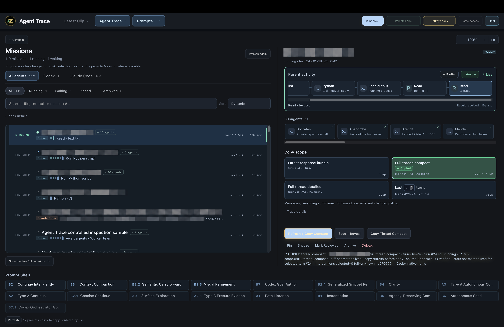

# Agent Trace — Codex execution history, usable by agents

Agent Trace turns Codex’s saved native records into context that people and agents can search, inspect and reuse while work continues.

## What it exposes

- **Commands and their actual outcomes:** arguments, working directory, exit code, duration and recorded output.
- **The edits themselves:** changed files and exact patch hunks, alongside the commands and messages around them.
- **Visible thinking summaries and conversation:** user requests, assistant updates, answers, model and effort changes.
- **The agent tree:** exact parent/child links, delegated work and each worker’s own execution history.
- **Tool activity:** MCP arguments/results and recorded web operations, with native item identities.
- **Live changes:** retrieve only the items added, updated or removed since the previous read. Earlier snapshots stay fixed.
- **Selective retrieval:** search commands, output text, patches or summaries; filter failures or item types; open one exact item or field.
- **Compact and detailed views:** commands/status without outputs; or expanded evidence with repeated bodies shared and large payloads available by reference. Latest-response and last-N-turn selection are available in the app.
- **Agent access:** the plugin and skill let an agent retrieve another chat or its workers directly, without manual copying.

The important part is the combination: **execution history becomes a queryable record of work across chats and agents**, with the original evidence still reachable.

## Inspect the mechanism

| Code | Responsibility |
|---|---|
| [Native core](src/trace_mechanism/codex_native.py) | JSONL and SQLite readers, canonical items, views, field retrieval and deltas |
| [Agent tools](src/trace_mechanism/agent_tools.py) | Thread trees, immutable snapshots, search and paging |
| [MCP server](src/trace_mechanism/mcp_server.py) | Callable agent interface |
| [Structured index](src/trace_mechanism/structurer.mjs) | Native actions and references into the supplied trace |

The native core and index builder are copied from the app; this repository supplies a smaller explicit-file MCP adapter. [Architecture](docs/mechanism.md) · [MCP setup](docs/mcp.md) · [Development](docs/development.md) · [Provenance](docs/provenance.json) · [Layout](tools/check_layout.py)

Before releasing the full app, I’d like feedback on the supported integration route and on exposing this much structured execution history for reuse.

[Apache-2.0](LICENSE) · Will Cook · [Security](SECURITY.md)
