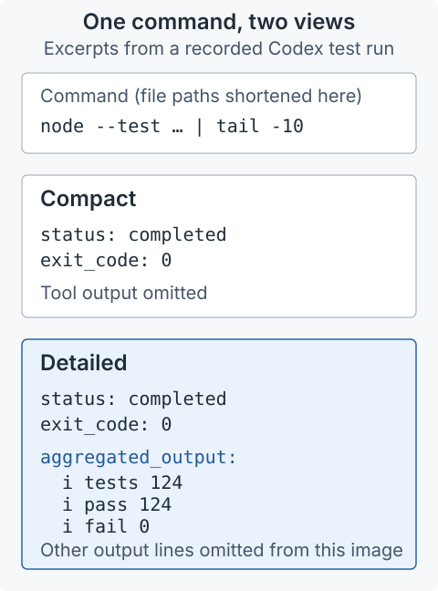
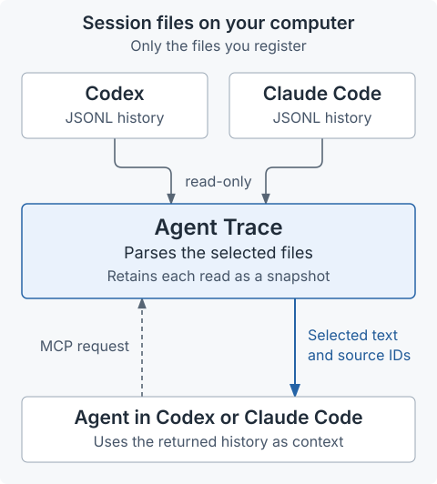

# Agent Trace

[](docs/images/agent-trace.png)

*Desktop app preview. You can install the history reader and agent tools today. The desktop app and its in-Codex interface aren't packaged yet; both would also be free and open source.*

**Let an agent read your earlier Codex and Claude Code conversations.**

Agent Trace reads the session files that Codex and Claude Code save on your computer. An agent in either app can read chats from both sources, including messages and recorded tool activity from a chat that is still running. You choose which session files it can access.

The **MCP (Model Context Protocol) server** runs locally and gives your agent tools for finding and reading those histories. The package also includes the underlying Python library. The desktop app shown above uses the same reader and adds automatic chat discovery, file watching and copy controls.

<a id="what-agent-trace-adds"></a>

## What it does

For **Codex and Claude Code histories**, an agent can find a selected chat by title or ID and read it in either view:

<a id="compact-and-detailed"></a>

| View | What it returns |
|---|---|
| **Compact** | Messages and tool-call previews, including commands and file paths where recorded. Tool results are omitted. Codex event records also provide visible reasoning summaries, command outcomes and changed paths. |
| **Detailed** | The conversation plus recorded tool inputs and results. For Codex event records, large outputs and patches have previews with references for retrieving the full value; repeated large text blocks appear once, with references where they recur. |

Compact is a filtered transcript, not an AI-written summary. Long responses are split into pages that the agent can request as needed.

<details>
<summary>See the difference on a real recorded command</summary>

<p align="center">
  
</p>

Both views include the command. Detailed also includes its output. This command pipes the tests through `tail`, so the exit code alone does not establish that the tests passed; the recorded test summary does. The image shows excerpts from [the actual validation history](docs/investigation.md).

An agent can also request just this command's output with `read_trace_item`, selecting the `/aggregated_output` field. It does not have to read the whole detailed conversation.

</details>

For **supported Codex event records**, an agent can also:

- **Find a specific operation:** search commands, outputs, patches and other recorded items by text, type or failure status. Each match identifies the field and matching passage.
- **Read just the relevant evidence:** retrieve one item, such as a command execution, or one field, such as its output. Results include session and item IDs so the agent can identify its source.
- **Include subagents:** search a parent chat and the child chats whose files you have also selected. Parent-child links are checked against the session records.
- **Check what changed:** compare two reads of a running chat to find added, updated or removed items. An unreadable child chat is reported as unavailable.

These queries use structured records of individual Codex operations, called *native items* in the code. They are not yet available for Claude histories or older Codex files that contain only conversation records. An agent in either app can query a supported Codex file.

<a id="run-or-inspect"></a>

## Try it

With Git and Python 3.10+ (macOS/Linux shell):

```sh
git clone https://github.com/wcook04/agent-trace-mechanism.git
cd agent-trace-mechanism
python3 -m venv .venv
.venv/bin/python -m pip install '.[mcp]'
.venv/bin/python tools/inspect_recorded_run.py
.venv/bin/python tools/inspect_agent_tree.py
.venv/bin/python tools/inspect_cross_provider.py
```

These retrieve a real validation history, a Codex review with two subagents, and a Claude review that read their findings through MCP. They print the results without running the recorded commands. No API key, private app or Node installation is needed. [Use your own chats in Codex or Claude →](docs/mcp.md#setup)

[A real investigation: checking a worker's failed tests, correction and retry →](docs/investigation.md)

[A fresh coordinator and two subagents reviewing this repository →](docs/agent-tree.md)

[Claude reads the Codex review, then Codex reads Claude’s findings →](docs/cross-provider.md)

## How it works

Each session file uses JSONL: one JSON record per line.

<p align="center">
  
</p>

1. **You choose the source files.** A local JSON configuration file, called the manifest, lists the session files the server may read. The server does not automatically add other chats.
2. **Agent Trace parses the records.** For Codex events, it combines updates to the same item ID into that item's latest recorded state. For Claude conversations, it pairs tool calls with their results and groups messages into turns.
3. **The agent requests what it needs.** MCP tools return conversation text, search matches or selected Codex items. The server retains the result of a read in memory as a *snapshot*, so later pages refer to the same version even if the source file grows. A fresh read picks up new records; snapshots last until the server exits.

The public server reads files on request, without changing them or executing the recorded commands. Continuous file watching is part of the desktop app. The requesting host may send retrieved text to its model provider. [Data access and privacy](SECURITY.md).

Start with [the Codex reader](src/trace_mechanism/codex_native.py), [the conversation parsers](src/trace_mechanism/parser.py) and [the retrieval adapter](src/trace_mechanism/agent_tools.py). [The MCP server](src/trace_mechanism/mcp_server.py) defines the callable tools.

[Usage and tool reference](docs/mcp.md) · [How records are processed](docs/mechanism.md) · [Development and repository map](docs/development.md)

<details>
<summary>Inside Codex</summary>

[](docs/images/codex-plugin.png)

The desktop app's plugin lets you select a chat and attach, copy or preview its context inside Codex. Agents can also retrieve context directly through its tools. This repository contains the reader and standalone MCP server used to inspect the mechanism.

</details>

## Why I built it

I built this while using AI for maths research and making videos and interfaces to help people understand the results.

The core is free and open source, and the full desktop app would be too, under the same Apache-2.0 licence. I won't charge for it. I've just got a lot on my plate, so I'd like to know if people would use it before I spend the time packaging it. If you would, [let me know what you'd use it for](https://github.com/wcook04/agent-trace-mechanism/issues). I'd be happy to make it available.

I'm also sharing this because I'd like more people to see my main projects. You can find them on [my homepage](https://wcook04.github.io/), or start with [the introduction video](https://www.youtube.com/watch?v=MBmVMMogXTA).

Apache-2.0; copyright 2026 Will Cook. Redistributed copies must retain the applicable notices under the licence. If you use Agent Trace in published work, please [cite it](CITATION.cff).

[Licence](LICENSE) · [Attribution](NOTICE) · Will Cook · [Source provenance](docs/provenance.json) · [Security](SECURITY.md)
