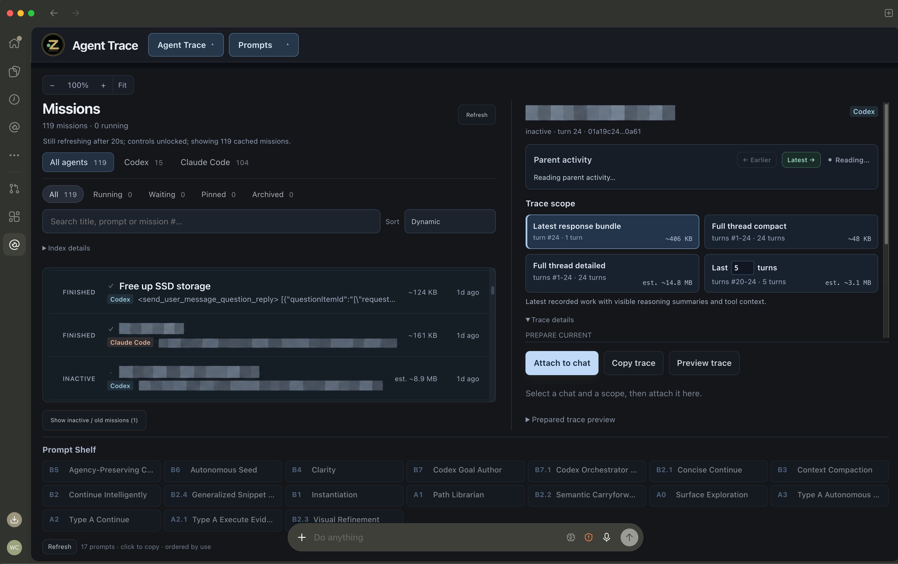

# Agent Trace

[](docs/images/agent-trace.png)

*Desktop app preview. This release contains the history readers and MCP server. The desktop app and its in-Codex interface aren't packaged yet; both would also be free and open source. The image shows a whole-thread export; the MCP tools also retrieve individual commands and fields.*

**Let agents in Codex and Claude Code read each other's work.**

Read a selected chat in a compact or detailed view. For Codex histories, search commands, outputs and patches individually, include registered workers, and retrieve changes as the work continues.

This repository contains a Python library and an MCP server for local Codex and Claude Code session files. You register the files it can read. The desktop app shown above uses the same reader and adds automatic discovery, file watching and copy controls.

<a id="what-agent-trace-adds"></a>
<a id="compact-and-detailed"></a>

## What it does

- **Search Codex activity:** search a selected chat and its registered workers by text, item type or recorded failure. Text matches identify the field and passage.
- **Read a Codex item or field:** retrieve one command, output, patch or field. Large values arrive in pages.
- **Keep a stable reference:** repeat a read from the same saved capture, even after the source changes.
- **Follow Codex progress:** retrieve added, updated and removed items since an earlier capture. An unreadable worker is reported as unavailable.
- **Read either conversation format:** compact keeps messages and tool-call previews; detailed adds recorded tool inputs and results. Codex views also retain visible thinking summaries, outcomes and changed paths, with large bodies available through references.

Chat lookup searches registered titles and IDs across both providers. Native item search, worker traversal and change queries currently read Codex records. Both hosts can call all these tools; the source format determines which operations are available.

<a id="run-or-inspect"></a>

## Try it

With Git and Python 3.10+ (macOS/Linux shell):

```sh
git clone https://github.com/wcook04/agent-trace-mechanism.git
cd agent-trace-mechanism
python3 -m venv .venv
.venv/bin/python -m pip install '.[mcp]'
.venv/bin/python tools/inspect_recorded_run.py
.venv/bin/python tools/inspect_agent_tree.py
.venv/bin/python tools/inspect_cross_provider.py
```

These retrieve a real validation history, a Codex review with two subagents, and a Claude review that read their findings through MCP. They print the results without running the recorded commands. No API key, private app or Node installation is needed. [Use your own chats in Codex or Claude →](docs/mcp.md#setup)

[A real investigation: checking a worker's failed tests, correction and retry →](docs/investigation.md)

[A fresh coordinator and two subagents reviewing this repository →](docs/agent-tree.md)

[Claude reads the Codex review, then Codex reads Claude’s findings →](docs/cross-provider.md)

## How it works

The Codex reader turns item events into records keyed by session, turn and item ID. The Claude parser pairs recorded tool calls with their results and groups them into conversation turns. The server selects a chat and its workers, saves a capture, then serves searches, fields and comparisons from it. Captures stay available until the server exits; a fresh capture rereads the files.

Start with [the Codex reader](src/trace_mechanism/codex_native.py), [the conversation parsers](src/trace_mechanism/parser.py) and [the retrieval adapter](src/trace_mechanism/agent_tools.py). [The MCP server](src/trace_mechanism/mcp_server.py) defines the callable tools.

[Usage and tool reference](docs/mcp.md) · [How records are processed](docs/mechanism.md) · [Development and repository map](docs/development.md)

<details>
<summary>Inside Codex</summary>

[](docs/images/codex-plugin.png)

The desktop app's plugin lets you select a chat and attach, copy or preview its context inside Codex. Agents can also retrieve context directly through its tools. This repository contains the reader and standalone MCP server used to inspect the mechanism.

</details>

## Why I built it

I built this while using AI for maths research and making videos and interfaces to help people understand the results.

The core is free and open source, and the full desktop app would be too, under the same Apache-2.0 licence. I won't charge for it. I've just got a lot on my plate, so I'd like to know if people would use it before I spend the time packaging it. If you would, [let me know what you'd use it for](https://github.com/wcook04/agent-trace-mechanism/issues). I'd be happy to make it available.

I'm also sharing this because I'd like more people to see my main projects. [Here's my introduction video](https://www.youtube.com/watch?v=MBmVMMogXTA), and [here's the maths reader](https://wcook04.github.io/lean-exposition-site/) if you'd like to have a look.

Apache-2.0; copyright 2026 Will Cook. Redistributed copies must retain the applicable notices under the licence. If you use Agent Trace in published work, please [cite it](CITATION.cff).

[Licence](LICENSE) · [Attribution](NOTICE) · Will Cook · [Source provenance](docs/provenance.json) · [Security](SECURITY.md)
